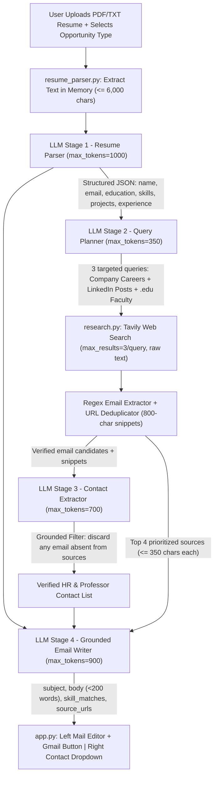
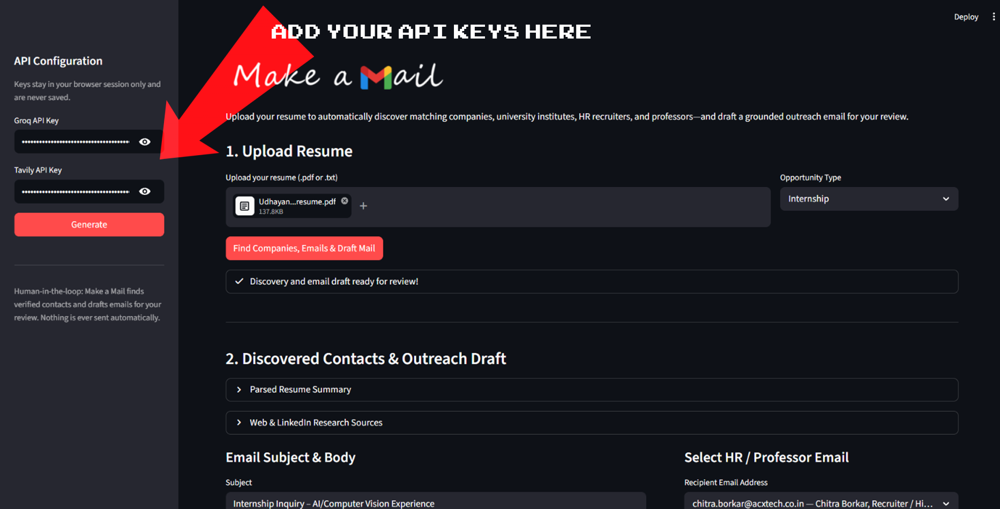
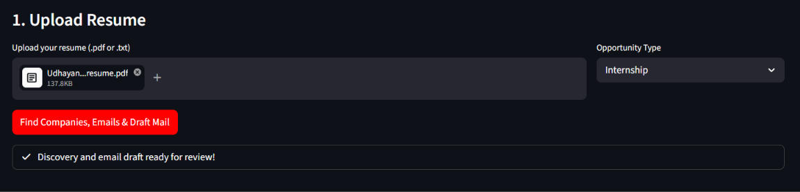
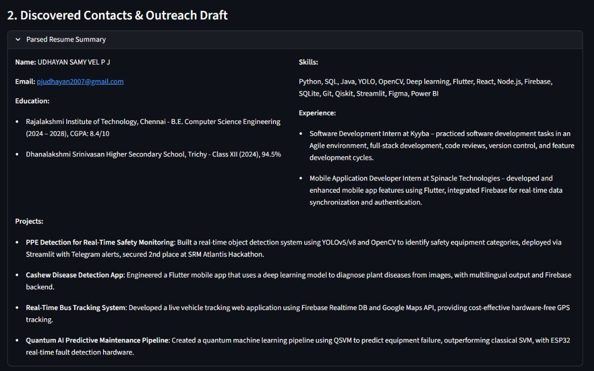
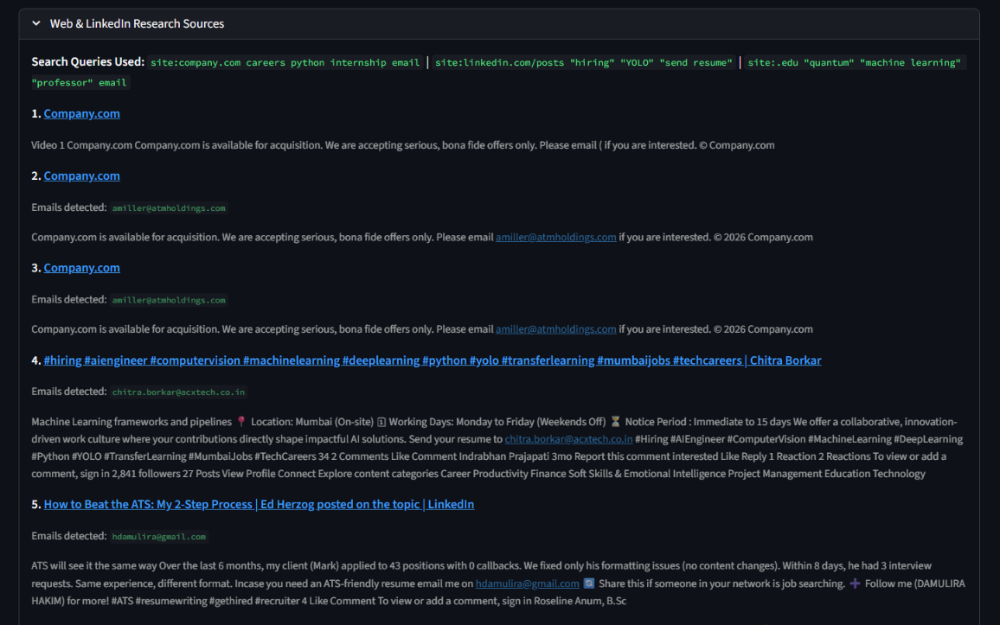
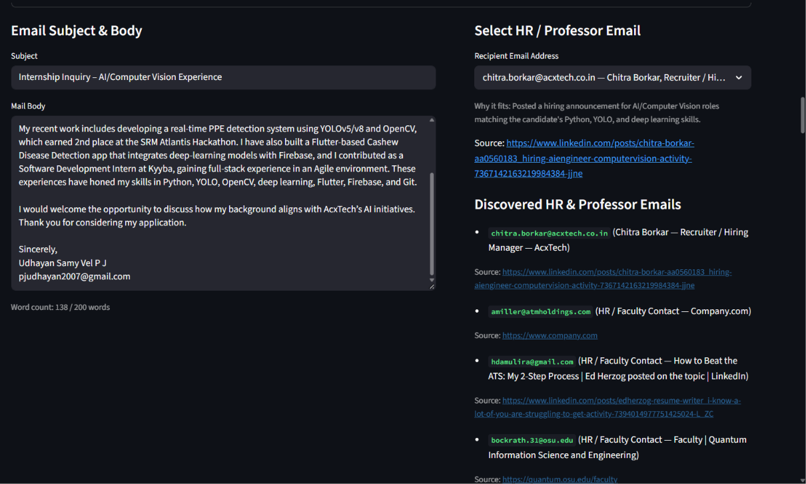
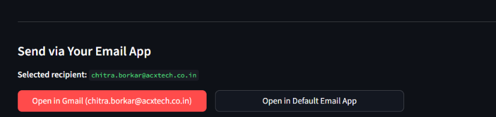
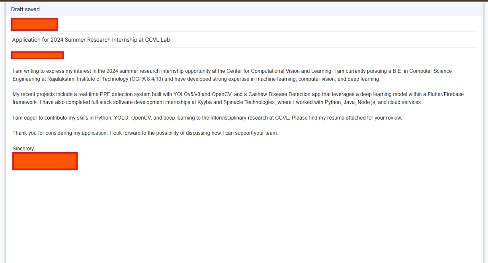

# Make a Mail

**Make a Mail** is an agentic outreach assistant built with **Streamlit**, **Groq (`openai/gpt-oss-120b`)**, and **Tavily** that reads your resume, discovers matching companies, academic institutes, HR recruiters, and professors along with their verified email IDs across the web and LinkedIn, and drafts a formal, fact-grounded outreach email ready to open directly in Gmail.

---

## Multi-Stage LLM & Search Architecture

Instead of relying on a single ungrounded prompt, **Make a Mail** orchestrates **four specialized LLM stages** (`openai/gpt-oss-120b` via Groq) around a **live web-search & regex verification layer** (`tavily-python`), all coordinated through one shared JSON helper (`call_llm_json` in `llm_helper.py`):



### How the Different LLM Stages Work Together

1. **Shared JSON Execution & Recovery (`llm_helper.py` -> `call_llm_json`)**:
   - Every LLM call targets `openai/gpt-oss-120b` on Groq with `reasoning_effort="low"`, `temperature=0.2`, and an explicit `max_tokens` ceiling.
   - Strips `<think>...</think>` blocks and markdown code fences, scans for JSON matching `expected_type` (`dict` or `list`) so preamble prose never triggers false matches, and automatically retries once with `"Return valid JSON only, no explanation"` if parsing fails.
2. **LLM Stage 1 — Structured Resume Parser (`resume_parser.py`)**:
   - Extracts raw text from `.pdf` (`pypdf.PdfReader`) or `.txt` in memory (capped at 6,000 characters) and instructs the LLM (`max_tokens=1000`) to return strict JSON (`name`, `email`, `education`, `skills`, `projects`, `experience`) without inventing missing fields.
3. **LLM Stage 2 — Search Query Planner (`research.py` -> `plan_queries`)**:
   - Infers matching domains, roles, and research areas from the parsed resume and opportunity type (`Internship`, `Research position`, `Job`), generating **3 focused search queries** (`max_tokens=350`) spanning company career pages, LinkedIn hiring posts (`site:linkedin.com/posts`), and `.edu` professor/lab directories.
4. **Tavily Search + Grounded Contact Verification (`research.py` -> `search` & `extract_contacts`)**:
   - Executes each query via `TavilyClient.search(..., max_results=3, include_raw_content="text")`, deduplicates by URL, and extracts plausible email addresses via regex across the full page text (filtering out placeholders and image/system addresses).
   - **LLM Stage 3** (`extract_contacts`, `max_tokens=700`) labels each contact's `name`, `role`, `organization`, and `reason` from email-bearing sources (trimmed to 300 chars each). Python then enforces a **hard grounding filter**: any email not literally present in the Tavily source text is dropped.
5. **LLM Stage 4 — Grounded Email Writer (`email_writer.py` -> `draft_email`)**:
   - Receives the parsed resume, verified contacts, and top 4 prioritized sources (`<= 350` chars each) to draft a formal email under **200 words** (`max_tokens=900`), citing only retrieved `source_urls` and explaining `skill_matches`. Automatically retries once if the body is empty.

---

## Step-by-Step Walkthrough (with Screenshots)

### Step 1 — Enter API Keys in the Sidebar & Launch
Enter your **Groq API Key** and **Tavily API Key** in the left sidebar (kept only in `st.session_state`, never logged or saved to disk) and click **Generate**.



### Step 2 — Upload Your Resume & Choose Opportunity Type
In **1. Upload Resume**, upload a `.pdf` or `.txt` resume and pick your **Opportunity Type** (`Internship`, `Research position`, or `Job`). You do **not** need to type any target company, HR name, or professor name—the agent discovers them automatically from your profile. Click **Find Companies, Emails & Draft Mail** (or **Generate** in the sidebar) to start.



### Step 3 — Inspect the Parsed Resume Summary
Under **2. Discovered Contacts & Outreach Draft**, expand **Parsed Resume Summary** to verify the structured details (`Name`, `Email`, `Education`, `Skills`, `Experience`, `Projects`) extracted solely from your uploaded file.



### Step 4 — Review Tavily Web & LinkedIn Research
Expand **Web & LinkedIn Research Sources** to inspect the exact 3 search queries generated from your skills, clickable source URLs across company pages, LinkedIn hiring posts, and `.edu` faculty directories, and the email addresses detected on each page.



### Step 5 — Edit the Mail Body & Choose an HR / Professor Email
The review workspace puts your editable **Email Subject & Body** (with live word count) on the left and the **Select HR / Professor Email** dropdown, discovered contact list, and grounded skill matches on the right. Switching the dropdown updates the target recipient immediately.



### Step 6 — Click Open in Gmail (Right Below the Body)
Immediately beneath the **Mail Body**—with no scrolling needed—click **Open in Gmail (`<selected_email>`)** to launch Gmail Compose pre-addressed to the selected HR recruiter or professor (or use **Open in Default Email App** / the copy-friendly box).



### Step 7 — Review & Send in Gmail
Your browser opens **Gmail Compose** with the **To** address, **Subject**, and **Body** pre-filled for final human review before you hit Send.



---

## Cost, Rate-Limit & Safety Controls

- **Groq 8,000 TPM Optimization**: Tuned token limits (`1000` / `350` / `700` / `900`) with `reasoning_effort="low"`, email-only source filtering in `extract_contacts`, and top-4 source trimming (`<= 350` chars) in `draft_email`.
- **Tavily Controls**: Capped at 3 planned queries and `max_results=3` per query, with 800-character grounded snippets.
- **No Auto-Sending**: The app never sends emails autonomously—human review is always required.
- **Zero Storage**: Uploaded resumes and API keys stay strictly in memory (`st.session_state`).

---

## Project Structure

```text
.
├── assets/
│   ├── logo.png              # Header banner used in README
│   ├── logo(bg-removed).png  # Transparent banner centered at the top of the app
│   └── 1.png ... 7.png       # Walkthrough screenshots
├── app.py                    # Streamlit UI, session key handling, Gmail & mailto export
├── llm_helper.py             # Shared Groq JSON caller with fence stripping & retry logic
├── resume_parser.py          # In-memory PDF/TXT extraction & structured JSON parsing
├── research.py               # Query planning, Tavily web/LinkedIn search & email verification
├── email_writer.py           # Grounded formal email drafting & URL verification
├── requirements.txt          # Python dependencies
├── .env.example              # Sample environment variable names
├── .gitignore                # Ignores .env, .streamlit/secrets.toml, caches, etc.
└── README.md
```

---

## Setup & Run Locally

1. Clone the repository and enter the project directory:
   ```bash
   git clone <your-repo-url>
   cd <your-repo-folder>
   ```
2. Install dependencies:
   ```bash
   pip install -r requirements.txt
   ```
3. (Optional) Copy `.env.example` to `.env` for local reference:
   ```bash
   cp .env.example .env
   ```
4. Start the Streamlit app:
   ```bash
   streamlit run app.py
   ```

## Privacy & Human-in-the-Loop Note

Uploaded resumes and API keys are processed strictly in memory for your active session and are never persisted. **Make a Mail** keeps a human in the loop at every step—you inspect the parsed resume, the retrieved sources, the discovered HR/professor emails, and the final Gmail draft before sending.
